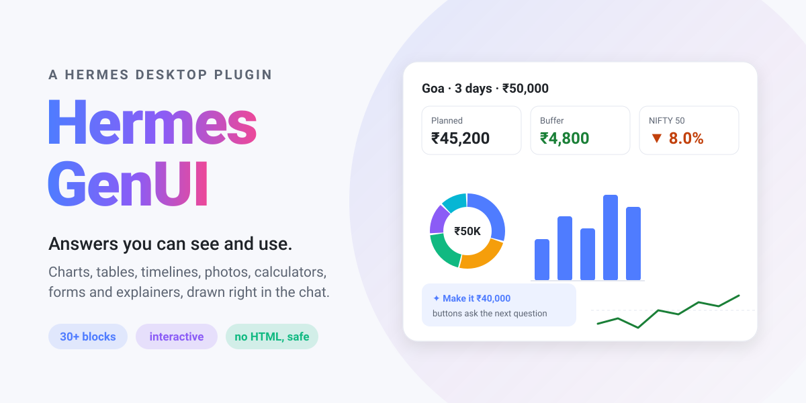
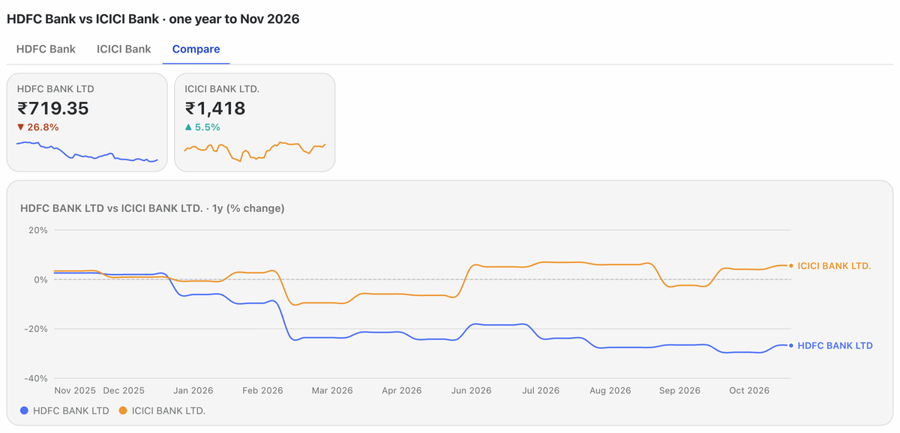
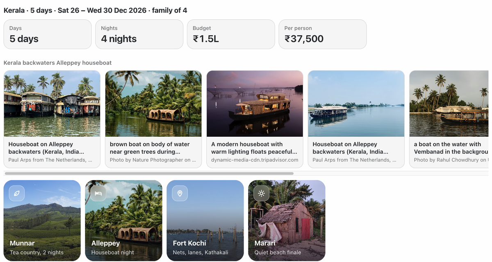
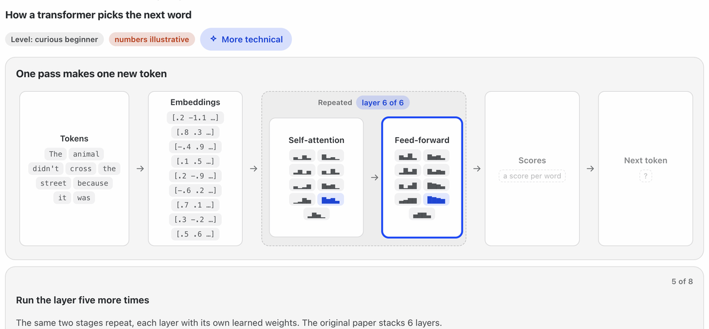
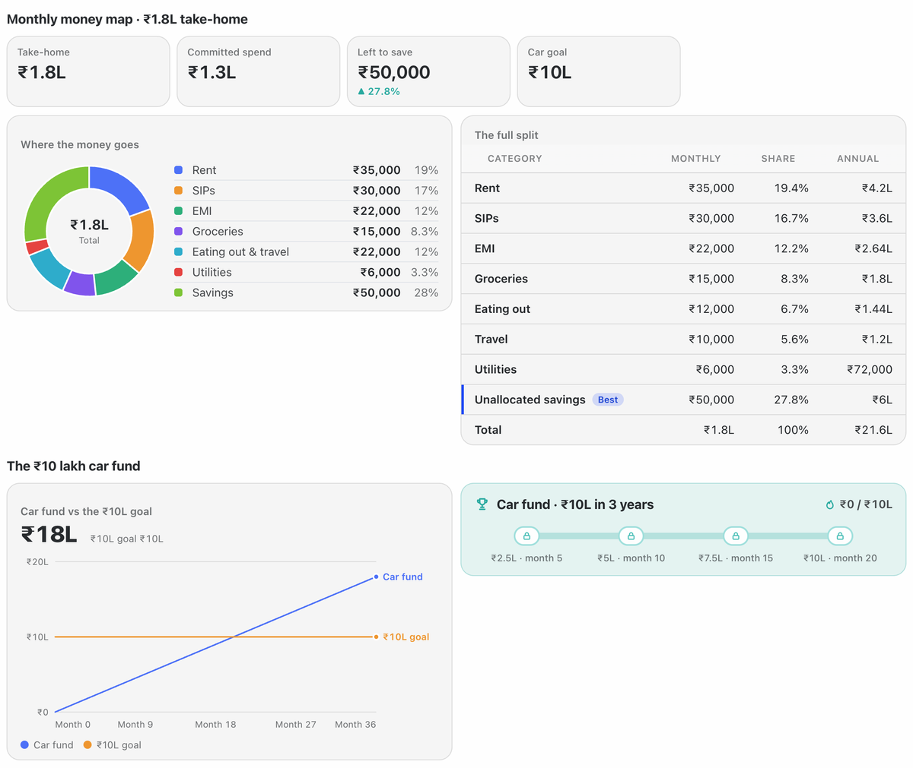
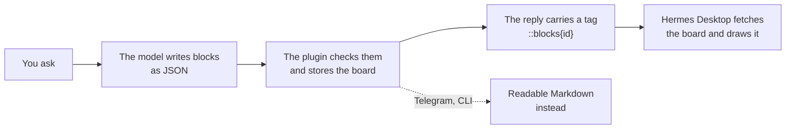

<p align="center">
  <picture>
    <source media="(prefers-color-scheme: dark)" srcset="assets/banner-dark.svg">
    
  </picture>
</p>

<p align="center">
  <a href="LICENSE"></a>
  
  
  
  <a href="https://github.com/sagarmainkar/hermes-genui/actions"></a>
</p>

<p align="center"><b>Ask "How's the market?" and get a chart, not a paragraph.</b><br>
Hermes GenUI lets your Hermes agent answer with <b>real, interactive UI</b> inside Hermes Desktop chat replies:
charts, tables, day-by-day plans, photo strips, calculators with live charts, forms, checklists that remember your
ticks, and step-by-step explainers.</p>

<p align="center">
  <br>
  <a href="assets/demo.mp4"><b>▶ Watch the 1-minute demo</b></a> (with sound): a Yosemite trip plan, a stock comparison, an explainer and a 401(k) what-if
</p>

---

## ✨ What it looks like

| | |
|:---:|:---:|
|  |  |
| **"Compare HDFC Bank and ICICI Bank over a year"** | **"Plan a ₹50,000 Goa trip for two"** |
|  |  |
| **"Explain how transformers work"** | **"Build me a personal finance dashboard"** |

The model decides **what** to show. The plugin decides **how** it looks, so every answer comes out in one
consistent, accessible design that follows your light or dark theme and your language's number format
(4.21B, 4,21 Mrd., ₹18.4L).

## 🧱 The blocks

| Family | Blocks |
|---|---|
| 📈 **Charts** | line (with gain/loss colouring), columns, horizontal bars, donut, pie, stacked, area, combo, heatmap, all with hover cards and keyboard support |
| 🔢 **Numbers** | KPI cards with trend lines, single stats, progress toward a goal, streaks |
| 📋 **Tables and lists** | sortable tables with mini bars, ranked lists with icons or photos |
| 🗓️ **Plans** | timelines (day by day, timed stops), checklists whose ticks are saved |
| 🖼️ **Media** | photo strips with credits, cover tiles, flash cards |
| 🎛️ **Interactive** | calculators with sliders and live charts, forms that ask before a big answer, buttons that ask the next question |
| 🧠 **Explainers** | flow diagrams whose boxes show what's inside them as you step through, simulations you play over time (with sliders), and stacks you can turn in 3D |
| 🧩 **Layout** | columns, grids, tabs, foldable sections, rows, headings, callouts, sources |

Plus **recipes**: ready-made plans the model follows for common asks. They cover trip planning, comparisons,
what-ifs, stock dashboards, dashboards, reports, learning, explainers and trackers. A **recipe builder** lets you
save your own.

## 💬 What you can ask

Just ask the way you normally would. The model picks the blocks, and for bigger asks it may show a short form first
to check the details.

| | Try asking |
|---|---|
| 📈 **Markets** | *How's the NIFTY doing this year?* · *Compare HDFC Bank, ICICI Bank and Kotak over a year* · *Build a dashboard comparing TCS, Infosys and Wipro, with a tab each* |
| 💰 **Money** | *EMI on a ₹40 lakh home loan, let me play with the rate* · *What will ₹10,000 a month in a SIP be worth in 15 years?* · *Build me a personal finance dashboard: take-home 1.8 lakh, rent 35k, …* |
| ✈️ **Trips and plans** | *Plan a 5-day Kerala trip for a family of four in December* · *Show me Hampi* · *A packing checklist for Ladakh in June* |
| 📊 **Reports** | *Write a report on India's electric vehicle market* · *Top 10 Indian companies by market cap* · *Where does my ₹50,000 budget go?* |
| 🧠 **Learn and explain** | *Explain how transformers work* · *How does a UPI payment work?* · *Explain how compound interest grows my money* · *Make me flash cards on photosynthesis* |
| 🔁 **Track** | *Track my 30-day walking streak* · *A checklist for moving house* (ticks are saved) |
| 🛠️ **Your own** | *Make this a recipe so you always build my weekly review this way* (the recipe builder saves it) |

Buttons under each board ask the obvious next question, such as *Make it ₹40,000*, *Add Thekkady* or *More
technical*, so you can keep going without typing.

## 🚀 Install

You need [Hermes Agent](https://github.com/NousResearch/hermes-agent) 0.22.5 or later with Hermes Desktop.

```bash
hermes plugins install sagarmainkar/hermes-genui --enable   # add -p <profile> for a profile other than default
hermes gateway restart                                       # loads the plugin's tools and data routes
```

Prefer clicking? In Hermes Desktop, open **Capabilities → Plugins → Install from Git** and enter
`sagarmainkar/hermes-genui`.

Then turn on the drawing half in Hermes Desktop:

1. Open **Capabilities → Plugins**.
2. Pick the **profile** you installed into at the top of the page. The list is per profile.
3. Open **hermes-genui** and switch **Desktop** on.

Start a new chat and try:

> *How's the NIFTY doing this year?* · *Compare TCS, Infosys and Wipro over a year* · *Plan a 5-day Kerala trip for
> a family of four* · *Explain how a UPI payment works* · *EMI on a ₹40 lakh home loan, let me play with the rate*

> [!TIP]
> **Recommended:** turn off tool search for the profile, so the plugin's tools are offered directly. Long layouts can
> break when they travel through the search bridge.
> ```bash
> hermes config set tools.tool_search.enabled off
> ```

### 🔑 Optional keys, for more and better photos

Photos work with **no keys at all**, from Wikimedia Commons, Openverse and the pictures on pages your own web search
finds. Each key below adds one more source. Add them under **Settings → Plugins → hermes-genui** in Hermes Desktop;
they're stored by Hermes, never by the plugin.

| Key | Adds | Get one |
|---|---|---|
| `UNSPLASH_ACCESS_KEY` | Unsplash photos (only the *Access Key*; the secret key is never used) | [unsplash.com/developers](https://unsplash.com/developers) |
| `PEXELS_API_KEY` | Pexels photos | [pexels.com/api](https://www.pexels.com/api/) |
| `TAVILY_API_KEY` | Tavily image search | [tavily.com](https://tavily.com) |

## 🔍 How it works



- **The model** learns the blocks from the `show_blocks` tool's description, and gets a short drawing rule in its
  system prompt.
- **Tools fetch real data:** `market_history` for prices, `find_photos` for photos. So numbers and pictures come from
  sources, not memory.
- **Every block is validated** before it's stored, and the model gets exact errors to fix. Desktop's readers also
  skip anything malformed, so a bad block never breaks the rest of the board.
- **Outside Desktop** (Telegram, the CLI and other chat apps), the same board is sent as readable Markdown.

## 🔒 Privacy, network and security

**What leaves your machine** (only when the model calls the tool that needs it):

| When | Who is contacted |
|---|---|
| Market prices | Yahoo Finance (`query1.finance.yahoo.com`) |
| Photos | Wikimedia Commons and Openverse APIs; Unsplash, Pexels or Tavily only if you added their keys; your configured web search; up to 256 KB of the top result pages (read only to their `</head>`) for their preview pictures; each photo host, briefly, to check the picture loads |

**What stays local:**
- Boards are saved as JSON in your profile, under `plugin-data/hermes-genui/`, with checklist ticks next to them.
- There's no telemetry and no account.

**What the plugin adds to the model's context:**
- a short drawing rule in the system prompt (under 1,500 characters);
- the `show_blocks` tool description (the block catalog);
- a one-line reminder next to messages that ask for something visual. This is added only in Desktop.

**Safety by design:**
- **The model never sends code.** It sends data only: no HTML, scripts or SVG. Every block is drawn by the plugin's
  own components.
- **Photos are fetched over https only, from public addresses only.**
  - DNS is pinned against rebinding.
  - Each redirect is checked again, up to 3.
  - Size and time limits apply.
- **Buttons can't send** slash commands, shell lines or `@file` references.
- **Calculator formulas** are read by a small parser with no `eval` and with operation budgets.
- **Board size, depth, text length and counts are all capped.**

Found a security issue? Please see [SECURITY.md](SECURITY.md).

## 🛠️ Troubleshooting

| You see | Do this |
|---|---|
| The plugin isn't in **Capabilities → Plugins** | Switch the profile selector at the top to the profile you installed it in. |
| "Couldn't load this block" | Run `hermes gateway restart` after installing or updating. |
| A board arrives as text | You're outside Hermes Desktop (Telegram, the CLI), which is by design. In Desktop, check the plugin's **Desktop** switch. |
| The model built an HTML widget instead | Start a new chat, or ask "draw it with blocks". Tool search being on can also cause this; see the tip above. |
| Few or slow photos | Add a photo key above. A source that fails is skipped automatically and retried after 10 minutes. |

## 🤝 Contributing

New recipes, fixes and new blocks are all welcome. See [CONTRIBUTING.md](CONTRIBUTING.md) for:
- the layout;
- how to add a recipe, a data tool or a block type;
- the checks every pull request must pass.

New block types start as an issue first. Each one costs space in the model's guide on every message, so we agree on
the design before the code.

## 💛 Credits

Built by [Sagar Mainkar](https://github.com/sagarmainkar), with Claude as a pair programmer. Made for the
[Hermes Agent](https://github.com/NousResearch/hermes-agent) community.

Sagar also makes **[Odie](https://github.com/sagarmainkar/odie)**, an open-source (MIT) personal assistant that lives
on your Mac and talks to you on your phone, with this kind of UI built in.

Released under the [MIT licence](LICENSE).
